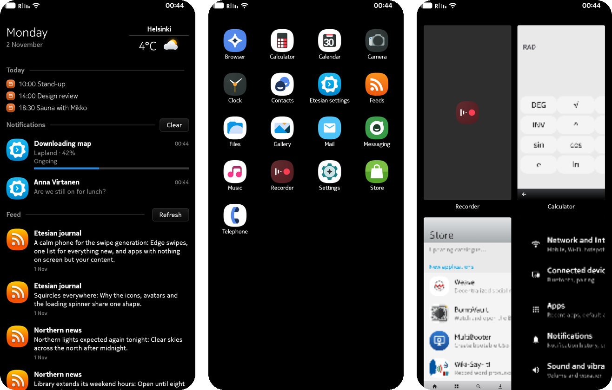
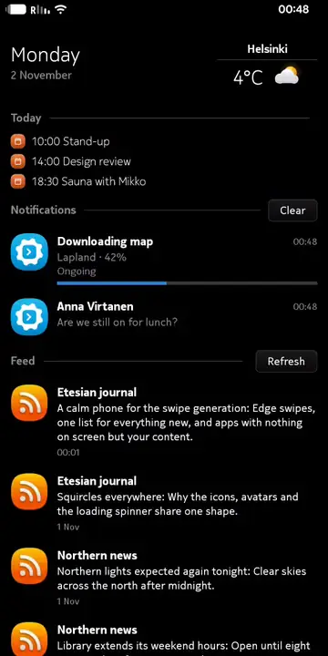

<p align="center">
  
</p>

<h1 align="center">Etesian</h1>

<p align="center">
  <b>A calm, gesture-first phone, for any phone running LineageOS.</b>
</p>

<p align="center">
  <a href="https://etesian-design.com/phone">Try it in your browser</a> ·
  <a href="https://etesian-design.com">Website</a> ·
  <a href="https://github.com/etesian-design/design">Design</a> ·
  <a href="https://github.com/etesian-design/plasma">KDE Plasma</a>
</p>

<p align="center">
  
  
  
  
</p>

---

No home button, no back button, just swipes from the edge of the screen. Its influence is the Nokia N9's Swipe UI,
re-envisioned for today. Everything new, from messages and calls to calendar entries and news, in one calm
list. Apps with big, plain type and nothing on screen that isn't your content.

<p align="center">
  
</p>

<p align="center"><sub>Real screenshots and a screen recording from the reference phone, with made-up calendar,
feeds and notifications (the launcher's demo mode).</sub></p>

It shipped on a single phone and then disappeared. **Etesian brings it back** on top of LineageOS, so it can run on any
phone LineageOS supports. It's developed and tested on the F(x)tec Pro1-X; another phone on the same LineageOS version
needs only its own build.

## What you get

- **Three home views.** Events, Applications and your open apps, side by side. Swipe between them.
- **Edge swipes.** Swipe in from any side to go home. Swipe down from the top to close an app.
- **Events.** Notifications, today's calendar and your RSS feeds in one list, with the weather.
- **Lock screen and status menu.** As on the N9: the time, your notifications, and a swipe to unlock.
- **The apps.** Phone, Messaging, Mail, Calendar, Music, Gallery and Settings, restyled to match.
- **Widgets.** An optional fourth view with Belle-style clocks, mail, feeds and toggles.

Anything the N9 didn't have is **off until you turn it on**. Out of the box, it's the N9.

## Status

Etesian is in development and there are **no downloads yet**. You can build it yourself, or
[try the interface in your browser](https://etesian-design.com/phone).

## Build

You need a LineageOS 24 build environment for your phone: follow your device's build guide on the
[LineageOS wiki](https://wiki.lineageos.org/devices/).

```sh
git clone https://github.com/etesian-design/android_vendor_etesian vendor/etesian
echo '$(call inherit-product, vendor/etesian/etesian.mk)' >> vendor/extra/product.mk
vendor/etesian/patches/apply.sh     # run again after every repo sync
brunch <your device>             # e.g. pro1x, the reference device
```

<details>
<summary>What's in this repository</summary>

| Folder | What it holds |
|---|---|
| `launcher/` | The home: its views, widgets, status menu and settings |
| `patches/` | Changes to LineageOS's own projects (SystemUI, Settings, the apps) |
| `overlay/`, `theme/`, `fonts/`, `sounds/`, `bootanimation/` | The look and sound |
| `mail/`, `feeds/`, `store/`, `toolbar/`, `fastscroll/` | Apps and shared parts |
| `tests/` | Tests that run on the phone (`tests/device/run.sh`) |
| `docs/` | Design notes |

If you own an N9, `n9-files/import.sh` can use its own font and tones in your build. They're copied from your phone to a
folder outside this repository and never committed.
</details>

## Licence

Apache 2.0, like AOSP and LineageOS. Fonts: Fira Sans, Ubuntu Sans and Archivo, under their own licences.

Etesian is an independent project. It isn't affiliated with Nokia and contains no Nokia files.
